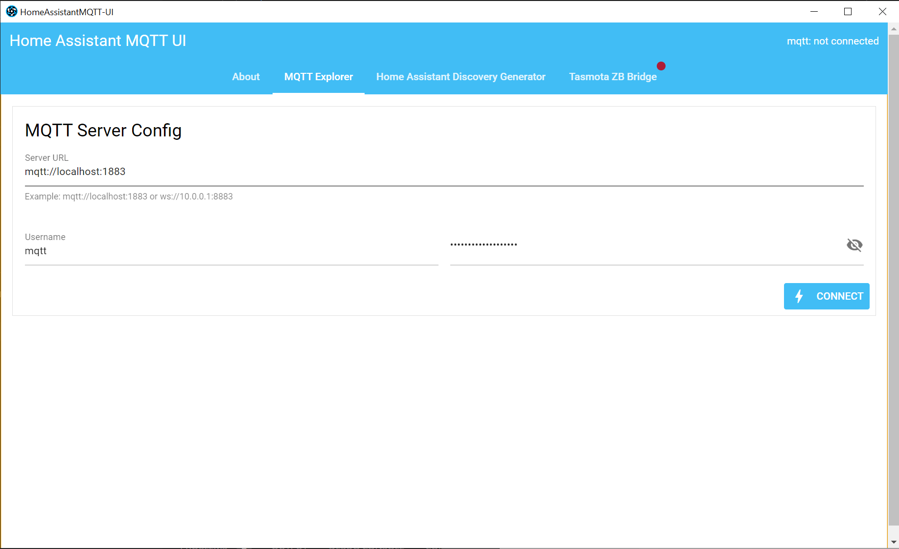
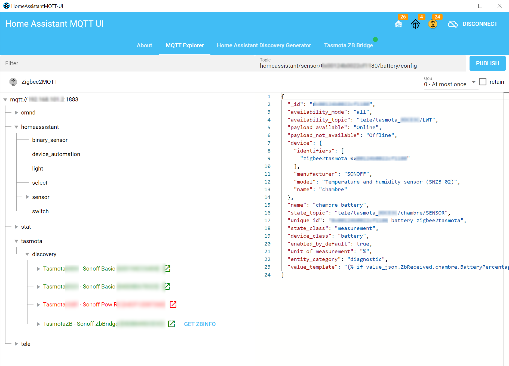
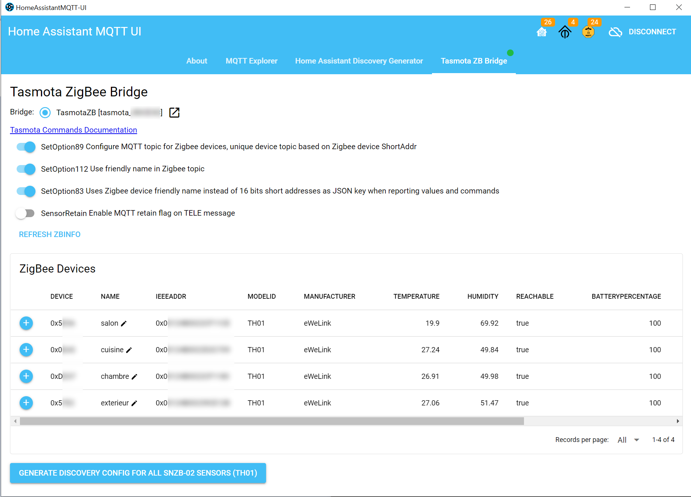
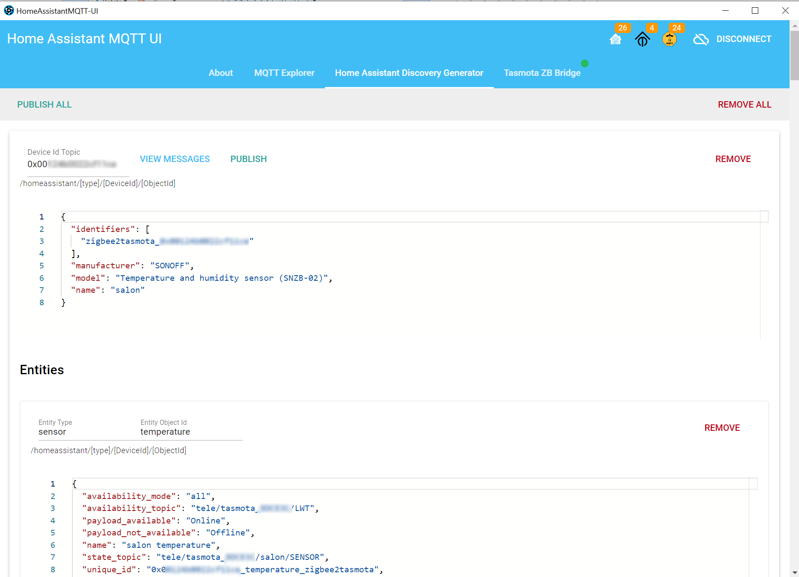

# Home Assistant MQTT UI (homeassistant-mqtt-ui)

UI to administer MQTT device discovery for Home Assistant

<div class="text-body1">
  Home Assistant MQTT UI is a small app to help configure custom MQTT
  devices for Home Assistant. Instead of creating a template you can use
  this app to publish a retained message to Home Assistant's MQTT Discovery
  topic. This allows to define sensors and other entities to a device, which
  is not supported via template.

The app has three main features:

  <ul>
    <li class="q-my-md">
      <b>MQTT Explorer*</b> - allows to explore MQTT topics specific to home
      assistant. Currently it knows about Home Assistant Discovery, Tasmota
      and Zigbee2MQTT. It can be used to explore and edit existing entries.
    </li>
    <li class="q-my-md">
      <b>Home Assistant Discovery Generator</b> - Helps in the creation of
      the Discovery message payload. Currently it has validation for
      <em>Sensor entities</em>.
    </li>
    <li class="q-my-md">
      <b>Tasmota ZB Bridge*</b> - Special feature to automatically detect
      Sonoff Zigbee Bridge (ZB Bridge) flashed with Tasmota. It can then
      help configure the device and automatically create the discovery
      message for Sonoff's SNZB-02 sensors (TH01).
      <ol>
        <li>Detect and configure Bridge</li>
        <li>Generate Discovery Config</li>
        <li>Publish All</li>
      </ol>
    </li>
  </ul>
  <small>* requires Desktop Version to connect to MQTT </small>
</div>

### Desktop

Download from the [release page](https://github.com/bfritscher/homeassistant-mqtt-ui/releases) or build your own.

#### _Linux_

App cannot be started by clicking on it, on Nautilus[\*](https://stackoverflow.com/questions/55060402/electron-executable-not-recognized-by-nautilus)

Make it executable and then you can run it from command line.

```
./'HomeAssistantMQTT-UI'
```

## Screenshots









# Development

## Install the dependencies

```bash
yarn
# or
npm install
```

### Start the app in development mode (hot-code reloading, error reporting, etc.)

```bash
quasar dev
quasar dev -m electron
```

### Lint the files

```bash
yarn lint
# or
npm run lint
```

### Format the files

```bash
yarn format
# or
npm run format
```

### Test discovery templates

The regression tests render generated templates with Python and Jinja2, including
partial Zigbee reports received before Home Assistant has an entity state.

```bash
python -m pip install Jinja2
npm test
```

Set `PYTHON` if your Python executable has a different name or path.

### Apply template fixes to existing devices

Connect to your broker and open **MQTT Explorer → Update published devices** to
scan received discovery messages. Use **Update** beside a device for a single
device. Expand **Review changes** to compare each field, select the entities to
update, then click **Publish selected**.

Updates replace recognized older SNZB-02 and TRVZB templates and remove the invalid
LQI device class. They preserve the original discovery topics, unique IDs, device
metadata and custom settings. Custom templates are left intact. No bridge scan or
device regeneration is required, and already updated entries are omitted.

Each entity shows its publish result. If a configuration changes while the preview
is open, reopen the preview to use its latest version. **Edit** continues to load
the existing configuration into Discovery Generator for manual editing.

Missing or invalid numeric fields produce an empty result, which Home Assistant
ignores for numeric MQTT sensors and climate temperatures. The last valid reading
is preserved; an entity without a reading stays unknown. HVAC mode templates retain
the actual entity's previous `heat`/`off` state, or return `None` if it is unknown:
[Home Assistant 2026.9's mode handler](https://github.com/home-assistant/core/blob/2026.9.2/homeassistant/components/mqtt/climate.py)
rejects empty modes. The updater also repairs the empty-mode templates from the
first version of this fix.
LQI retains its unit and diagnostic metadata without an unsupported device class.

If numeric `unknown` exceptions appear during discovery updates, reload the MQTT
integration in Home Assistant after publishing the fixes. Existing entities can
still hold invalid string values produced by their old templates; changing their
configuration does not clear that in-memory value. A new valid sensor report can
also replace it. Check for new errors after the reload; earlier log entries remain.

### Build the app for production

```bash
quasar build
quasar build -m electron
```

### Customize the configuration

See [Configuring quasar.config.js](https://v2.quasar.dev/quasar-cli-vite/quasar-config-js).
